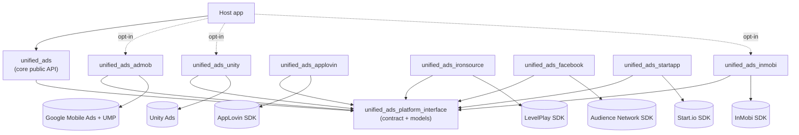
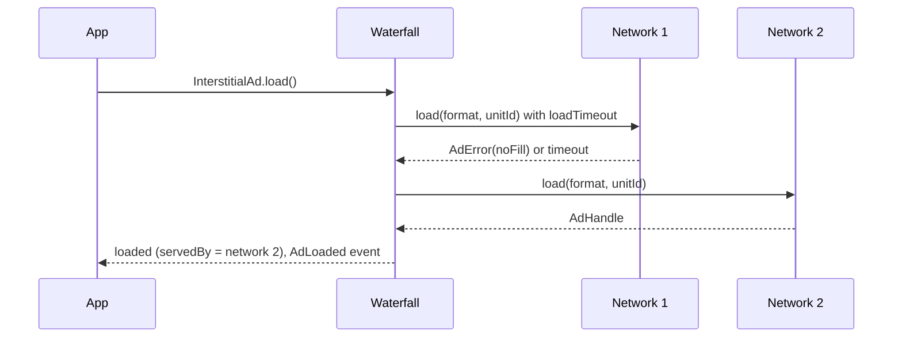

# unified_ads

[](https://github.com/rsagar024/unified_ads/actions/workflows/ci.yaml)
[](https://github.com/rsagar024/unified_ads/actions/workflows/ios.yml)
[](https://pub.dev/packages/unified_ads)
[](LICENSE)

**One Dart API for banner, interstitial and rewarded ads across AdMob, AppLovin MAX, Unity Ads, ironSource LevelPlay,
InMobi, Start.io and Facebook Audience Network, linking only the ad SDKs you choose.**

```dart
await UnifiedAds.init(AdConfig(
  testMode: true,
  waterfall: [AdNetwork.admob, AdNetwork.unity, AdNetwork.inmobi],
  networks: {
    AdNetwork.admob: NetworkConfig(appId: '…', interstitialAdUnitId: '…', rewardedAdUnitId: '…'),
    AdNetwork.unity: NetworkConfig(appId: '…', interstitialAdUnitId: '…', rewardedAdUnitId: '…'),
    AdNetwork.inmobi: NetworkConfig(appId: '…', interstitialAdUnitId: '…', rewardedAdUnitId: '…'),
  },
));

final ad = InterstitialAd(onClosed: (ad) => print('served by ${ad.servedBy}'));
if ((await ad.load()).isSuccess) await ad.show();   // tries AdMob → Unity → InMobi
```

## Why

- **Opt-in networks:** each network is its own package. Depend on `unified_ads_admob` + `unified_ads_unity` and *only*
  those SDKs end up in your APK / IPA. CI checks this on every push: [`tool/verify_opt_in.sh`](tool/verify_opt_in.sh)
  builds an app with AdMob + Unity + InMobi and fails if any other network's Gradle artifact or Swift package is resolved. See
  [Architecture → Opt-in linking](#opt-in-linking-how-excluded-sdks-never-reach-the-binary).
- **Waterfall fallback** with per-network timeouts, **preloading**, **frequency capping**, one `AdError` model, and unified events.
- **Never crashes the host app:** every native failure becomes an `AdError`.
- **Consent and ATT:** a Google UMP provider, a pluggable `ConsentProvider`, and an App Tracking Transparency helper
  ([Consent and ATT](#consent-gdpr--us-privacy--coppa-and-att)).
- **Config in code or in `pubspec.yaml`:** `AdConfig`, or a declarative `unified_ads:` section turned into
  `ads_config.json` by `dart run unified_ads:generate_config`.

## Contents

- [Packages](#packages) · [Feature matrix](#feature-matrix) · [Requirements](#requirements)
- [Quick start](#quick-start) · [Configuration](#configuration) · [API overview](#api-overview)
- [Getting your ad IDs](#getting-your-ad-ids) · [Platform setup](#platform-setup)
- [Consent and ATT](#consent-gdpr--us-privacy--coppa-and-att) · [Architecture](#architecture)
- [SDK status](#sdk-status) · [Single-package mode](#single-package-mode-alternative-android-only)
- [Example app](#example-app) · [Migration notes](#migration-notes) · [Development](#development) · [Further reading](#further-reading)

## Packages

| Package | Purpose |
|---|---|
| [`unified_ads`](https://pub.dev/packages/unified_ads) | Public API: `UnifiedAds`, `InterstitialAd`, `RewardedAd`, `RewardedInterstitialAd`, `AppOpenAd`, `BannerAd`, `UnifiedBannerWidget` |
| [`unified_ads_platform_interface`](https://pub.dev/packages/unified_ads_platform_interface) | Adapter contract + shared models (re-exported by `unified_ads`) |
| [`unified_ads_admob`](https://pub.dev/packages/unified_ads_admob) | Google AdMob + UMP consent |
| [`unified_ads_applovin`](https://pub.dev/packages/unified_ads_applovin) | AppLovin MAX |
| [`unified_ads_unity`](https://pub.dev/packages/unified_ads_unity) | Unity Ads |
| [`unified_ads_ironsource`](https://pub.dev/packages/unified_ads_ironsource) | ironSource / Unity LevelPlay |
| [`unified_ads_inmobi`](https://pub.dev/packages/unified_ads_inmobi) | InMobi |
| [`unified_ads_startapp`](https://pub.dev/packages/unified_ads_startapp) | Start.io |
| [`unified_ads_facebook`](https://pub.dev/packages/unified_ads_facebook) | Facebook Audience Network, branded Meta (bidding-only: test ads direct, revenue via mediation) |

## Feature matrix

| Network | Banner | Interstitial | Rewarded | Rewarded interstitial | App open | Meta bidding ³ | Android | iOS | Package min (Android API / iOS) | Test mode | Device-verified (Android) |
|---|---|---|---|---|---|---|---|---|---|---|---|
| AdMob | ✅ | ✅ | ✅ | ✅ | ✅ | ✅ opt-in | ✅ (GMA Next-Gen) | ⏳ CI | 24 / 13 | test devices | ✅ test ads serve (all 5 formats load; Next-Gen) |
| AppLovin MAX | ✅ | ✅ | ✅ | — | ✅ | ✅ opt-in | ✅ | ⏳ CI | 24 / 13 | test devices | needs your SDK key |
| Unity Ads | ✅ | ✅ | ✅ | — | — | — | ✅ | ⏳ CI | 24 / 13 | flag | ✅ test ads serve |
| LevelPlay | ✅ | ✅ | ✅ | — | — | ✅ opt-in | ✅ | ⏳ CI | 24 / 13 | test suite only ² | initializes; fill needs your app key + networks |
| InMobi | ✅ | ✅ | ✅ | — | — | — | ✅ | ⏳ CI | 24 / 13 | dashboard only ² | initializes; fill needs your placements |
| Start.io | ✅ | ✅ | ✅ | — | — | — | ✅ | ⏳ CI | 24 / 13 | flag | ✅ test ads serve |
| Facebook Audience Network ¹ | ✅ | ✅ | ✅ | — | — | n/a | ✅ | ⏳ CI | 24 / **15** | test devices | ✅ banner + interstitial test ads; rewarded needs your placement |

¹ Bidding-only: a direct load serves test ads but is not expected to fill in production; for revenue use
[Meta bidding](#meta-facebook-bidding-through-mediation-opt-in).
² `testMode` cannot force test ads for this network; init logs a warning. Use the vendor's dashboard or test suite.
³ Meta (Facebook) demand through the mediation platform's bidding. You opt in by adding the vendor's Meta adapter to your
app; the package detects it and forwards privacy. No Meta SDK is linked otherwise. See
[Meta bidding](#meta-facebook-bidding-through-mediation-opt-in).
"—" = the SDK has no such format; the waterfall skips that network for it.

Column legend:

- ✅ **Android:** compiled against the pinned SDK, with Kotlin and Dart unit tests.
- ⏳ **CI (iOS):** Swift sources are built by the CI macOS job (`flutter build ios --no-codesign`, Swift Package
  Manager only since 1.1.0). iOS hasn't run on a physical device yet.

`RewardedInterstitialAd` and `AppOpenAd` use the same waterfall, cache, frequency caps and callbacks as the other formats.

## Requirements

| | Minimum |
|---|---|
| Flutter / Dart | Flutter **3.44+** / Dart **3.12+** |
| Android | **minSdk 24** (AdMob and AppLovin MAX need it), compileSdk 35+, Kotlin 2.1+ (InMobi needs Kotlin 2.x and AGP ≥ 8.9.3) |
| iOS | **13.0**, or **15.0** with `unified_ads_facebook` or any Meta bidding adapter; Xcode **26.2+** |
| iOS build system | **Swift Package Manager only** (since 1.1.0). CocoaPods is not supported. SPM is on by default on stable (`flutter config --enable-swift-package-manager`) |

Two rules to know up front:

- **Don't enable Unity Ads and LevelPlay together.** The Unity SDK initializes once per process, so unified_ads skips
  `unity` with `configConflict`. Get Unity demand through LevelPlay mediation instead.
- **AdMob on Android uses the GMA Next-Gen SDK**, which can't share an app with the legacy `play-services-ads` (for
  example the official `google_mobile_ads` plugin, or a Google mediation adapter that pulls it). Exclude the legacy SDK
  if something brings it in (see [Migration notes](#migration-notes)).

## Quick start

1. Add the core and the networks you want:
   ```yaml
   dependencies:
     unified_ads: ^1.1.0
     unified_ads_admob: ^1.1.0
     unified_ads_unity: ^1.1.0
   ```
   Adapters register themselves (`dartPluginClass`); nothing else to wire up.
2. Do each network's platform setup (manifest / Info.plist entries, SKAdNetwork IDs, privacy):
   see [Platform setup](#platform-setup).
3. At startup: **ATT → consent → init**:
   ```dart
   await UnifiedAds.requestTrackingAuthorization();              // iOS prompt; no-op on Android
   await UnifiedAds.gatherConsent(const AdmobConsentProvider()); // Google UMP form if required
   final result = await UnifiedAds.init(config);                 // never throws; see result.failed / skipped
   ```
4. Show ads:
   ```dart
   final rewarded = RewardedAd(onEarnedReward: (ad, reward) => grant(reward.amount));
   if ((await rewarded.load()).isSuccess) await rewarded.show();

   final banner = BannerAd(size: const BannerSize.adaptiveAnchored());
   // in build(): UnifiedBannerWidget(ad: banner, anchored: true)
   ```

## Configuration

### In code: `AdConfig`

```dart
AdConfig(
  testMode: true,                                   // global; NetworkConfig.testMode overrides per network
  waterfall: [AdNetwork.admob, AdNetwork.unity, AdNetwork.inmobi],   // priority order
  networks: {
    AdNetwork.admob: NetworkConfig(
      appId: PlatformValue.select(android: 'ca-app-pub-…~…', ios: 'ca-app-pub-…~…'),
      bannerAdUnitId: '…',
      interstitialAdUnitId: '…',
      rewardedAdUnitId: '…',
      rewardedInterstitialAdUnitId: '…',            // optional stretch formats
      appOpenAdUnitId: '…',
      enabled: true,                                // per-network switch
      enabledFormats: {AdFormat.banner, AdFormat.interstitial, AdFormat.rewarded}, // per-format switch
      testDeviceIds: ['<hashed device id>'],
      extras: {},                                   // network-specific options (reward amount, userId, …)
    ),
  },
  loadTimeout: Duration(seconds: 10),               // per waterfall attempt
  initTimeout: Duration(seconds: 20),               // per network
  showTimeout: Duration(seconds: 15),               // show() gives up if the SDK never answers
  preload: PreloadPolicy(formats: {AdFormat.interstitial, AdFormat.rewarded}, onInit: false),
  frequencyCaps: {AdFormat.interstitial: FrequencyCap(maxShows: 3, per: Duration(hours: 1))},
  cacheTtl: Duration(hours: 1),                     // cached ads expire and reload transparently
)
```

- `appId` holds each network's **app-level credential**: AdMob App ID, Unity Game ID, MAX SDK key, LevelPlay App Key,
  InMobi Account ID, Start.io App ID (Facebook needs none). See [Getting your ad IDs](#getting-your-ad-ids).
- Use `PlatformValue.select(android: …, ios: …)` for any ID that differs per platform (most do).
- **Build-time IDs:** the AdMob App ID must *also* be in `AndroidManifest.xml` and `Info.plist`.
- **Test mode is best effort per network** (see [Test-mode capability](#test-mode-capability-per-network)). Never ship
  test mode or test IDs in production.

### Declarative: `pubspec.yaml` → `ads_config.json`

```yaml
unified_ads:
  testMode: true
  waterfall: [admob, unity]
  networks:
    admob:
      appId: {android: 'ca-app-pub-…~…', ios: 'ca-app-pub-…~…'}
      interstitialAdUnitId: '…'
    unity:
      appId: '…'
      interstitialAdUnitId: '…'

flutter:
  assets:
    - assets/ads_config.json
```

```sh
dart run unified_ads:generate_config   # writes assets/ads_config.json; --set-exit-if-changed for CI
```

```dart
final config = (await AdConfigLoader.fromAsset('assets/ads_config.json')).valueOrNull!;
await UnifiedAds.init(config);
```

The schema matches `AdConfig` one to one: any ID may be a string or `{"android": …, "ios": …}`, and network keys are
`admob`, `applovin`, `unity`, `ironsource`, `inmobi`, `startapp`, `facebook`. The generator and loader validate the
section and report errors with a JSON path (`invalidConfig: $.networks.foo: unknown network`). No `build_runner`, and it
works with hot restart. You can also write `assets/ads_config.json` by hand; `AdConfigLoader.fromJson` /
`fromJsonString` / `toJson` are available too.

## API overview

```dart
// Init: never throws.
final InitResult result = await UnifiedAds.init(config);
result.ready;      // networks that initialized
result.failed;     // network → AdError
result.skipped;    // network → AdError (adapter missing, disabled, Unity+LevelPlay conflict, MAX + COPPA)
UnifiedAds.isInitialized;   // true once at least one network is ready

// Full-screen formats: InterstitialAd, RewardedAd, RewardedInterstitialAd, AppOpenAd.
final ad = InterstitialAd(
  forceNetwork: null,                  // set to bypass the waterfall
  onLoaded: (ad) {}, onFailedToLoad: (ad, error) {},
  onShown: (ad) {}, onFailedToShow: (ad, error) {},
  onImpression: (ad) {}, onClicked: (ad) {}, onClosed: (ad) {},
);
final loaded = await ad.load();        // AdResult: isSuccess / error
ad.isReady;                            // loaded and not expired
await ad.show();
ad.servedBy;                           // AdNetwork that actually served it

final rewarded = RewardedAd(onEarnedReward: (ad, RewardItem reward) => print('${reward.amount} ${reward.type}'));

// Banner
final banner = BannerAd(size: const BannerSize.adaptiveAnchored(), onLoaded: (ad) {});
UnifiedBannerWidget(ad: banner, anchored: true, placeholder: const SizedBox(), collapseWhenFailed: true);
banner.dispose();

// Cache / preload, events, logging, lifecycle
await UnifiedAds.preload(AdFormat.rewarded);
UnifiedAds.hasCachedAd(AdFormat.interstitial);
UnifiedAds.events.listen((AdEvent e) => print('${e.network} ${e.format} $e'));
UnifiedAds.logger = const AdsLogger.console(level: AdsLogLevel.debug);   // silent by default
await UnifiedAds.dispose();
```

| Concept | Details |
|---|---|
| Banner sizes | `BannerSize.standard` (320×50), `.largeBanner` (320×100), `.mediumRectangle` (300×250), `.leaderboard` (728×90), `.adaptiveAnchored({width})`, `.adaptiveInline({width, maxHeight})`. The widget passes the available width, native resolves the real size, and the widget animates to it. Networks without adaptive sizes fall back to 320×50. |
| Anchoring | `anchored: true` wraps the banner in `SafeArea`; inline banners are laid out by the parent (works in scrolling lists). Taps go to the native view; drags still scroll the parent. |
| Events | sealed `AdEvent`: `AdLoaded`, `AdFailedToLoad`, `AdFailedToShow`, `AdShown`, `AdImpression`, `AdClicked`, `AdClosed`, `AdEarnedReward(RewardItem)`, `BannerSized(width, height)`. Each carries `network`, `adId`, `format`, `timestamp`. Order per ad: loaded → shown/impression → clicked* → earnedReward? → closed. |
| Waterfall | networks = `waterfall` ∩ ready ∩ supports(format) ∩ enabled formats, each tried with `loadTimeout`. If all fail you get `AdError(noFill)` with an `attempts` list (one `AdError` per network). |
| Cache + preload | one slot per full-screen format; formats in `PreloadPolicy.formats` reload automatically after `closed` / `failedToShow`; `onInit: true` preloads right after init; the next `load()` takes the cached ad; expired ads (`cacheTtl`) are destroyed and reloaded. |
| Frequency caps | `FrequencyCap(maxShows, per)` per format (sliding window). `show()` returns `AdError(frequencyCapped)` without touching native code. |
| Errors | `AdError { code, message, network, nativeCode, attempts }`. `nativeCode` always keeps the SDK's original code. |
| Logging | `AdsLogger` levels `verbose < debug < info < warning < error < none`; silent by default; plug in a custom sink (e.g. Crashlytics). Ad unit IDs are partially masked. |
| Lifecycle | `UnifiedAds.init` first disposes the previous session (hot restart safe); `dispose()` is idempotent; banners destroy their native view on dispose. |
| Testing | `package:unified_ads/testing.dart` → `FakeAdNetworkAdapter` (scriptable: succeed, fail, timeout, delayed events); pass it with `UnifiedAds.init(config, adapters: [...])`. |

### `AdErrorCode`

| Code | Raised when |
|---|---|
| `notInitialized` | an API is used before `UnifiedAds.init` |
| `invalidConfig` | config / JSON validation fails (message includes the field path), or the SDK rejects an ID |
| `configConflict` | Unity + LevelPlay are both enabled; MAX is used with COPPA |
| `adapterMissing` | the config enables a network whose adapter package isn't installed |
| `initializationFailed` | the native SDK init failed or timed out |
| `unsupportedFormat` | the network doesn't support the format |
| `unsupportedNetwork` | a documented stub adapter (none of the seven networks currently) |
| `formatDisabled` / `networkDisabled` | disabled by config |
| `noFill` | no ad available (the waterfall aggregates `attempts`) |
| `timeout` | load exceeded `loadTimeout` (or show exceeded `showTimeout`) |
| `networkError` | connectivity or server errors reported by the SDK |
| `notReady` | show was called with no loaded or valid ad |
| `alreadyShowing` | show was called while another full-screen ad is visible |
| `frequencyCapped` | the frequency cap was hit |
| `showFailed` | the SDK reported a show failure |
| `noActivity` | no foreground Activity or ViewController is available |
| `internal` | anything unexpected (the original exception is kept in `message`) |

**Never-crash guarantees:** Kotlin and Swift wrap every host-API body in `try/catch`; Pigeon errors become
`PlatformException`, which the adapter maps to `AdError`; core wraps every adapter call in a guard that reports
`internal`; a throwing user callback is logged and doesn't break the ad pipeline.

## Getting your ad IDs

Every network needs an **app-level credential**, and most also need **one ID per ad format**:

| Network | Console | App-level credential → `appId` | Per-format IDs | Also put the app ID in |
|---|---|---|---|---|
| AdMob | [admob.google.com](https://admob.google.com) | **App ID** `ca-app-pub-XXXXXXXXXXXXXXXX~YYYYYYYYYY` (one per platform) | **Ad unit IDs** `ca-app-pub-XXXXXXXXXXXXXXXX/NNNNNNNNNN` | `AndroidManifest.xml` + `Info.plist` (**required**) |
| AppLovin MAX | [dash.applovin.com](https://dash.applovin.com) | **SDK key** (account level) | **MAX ad unit IDs** (bound to your package name / bundle ID) | — |
| Unity Ads | [cloud.unity.com](https://cloud.unity.com) | **Game ID**: one for Android, one for iOS | **Placement IDs** | — |
| LevelPlay | [platform.ironsrc.com](https://platform.ironsrc.com) | **App Key** (one per app/platform) | **Ad unit IDs** (+ enable demand networks) | — |
| InMobi | [publisher.inmobi.com](https://publisher.inmobi.com) | **Account ID** | **Placement IDs** (numeric) | — |
| Start.io | [portal.start.io](https://portal.start.io) | **App ID** | *none*: optional free-form ad tags | — |
| Facebook Audience Network | [Monetization Manager](https://business.facebook.com/pub/start) | *none* | **Placement IDs** (one per format) | Test device hash |

**Tips for every network**

- Create **one app per platform** (Android and iOS get different IDs) and use `PlatformValue.select`.
- Use the **exact** package name (Android `applicationId`) and bundle ID (iOS). Several networks bind ads to it.
- New apps and units can take **hours to days** to start serving (approval, app review, propagation). Use test mode meanwhile.
- Publish an **`app-ads.txt`** file on your developer website. AdMob requires it for new apps, and many advertisers won't bid without it.
- **Never ship test mode or test IDs** in a production build.

<details>
<summary><b>AdMob</b>: App ID per platform + one ad unit ID per format</summary>

1. **Account:** sign in at [admob.google.com](https://admob.google.com), choose your country (can't be changed later),
   accept the terms, verify a phone number and submit payment details. Verification takes up to 24 hours.
2. **App:** **Apps → Add app** → Android or iOS. Published: search the store listing. Not published: enter a name and
   link the store later. Each app goes through a **readiness review** (2–3 days) once it's published and linked.
3. **App ID:** **Apps → View all apps** → copy the **App ID** column. Format `ca-app-pub-…~…` (note the **`~`**).
4. **Ad units:** **Apps → your app → Ad units → Add ad unit** → **Banner**, **Interstitial** or **Rewarded** (set the
   reward amount and item; they become your `RewardItem`) → **Create ad unit**. Format `ca-app-pub-…/…` (note the **`/`**).
5. **Testing:** **Settings → Test devices**, or put the hashed ID the SDK prints to logcat / Xcode console into
   `testDeviceIds`. Google's demo ad units always serve test ads.
6. **Consent:** **Privacy & messaging** → create a **GDPR** message (and a **US state regulations** message if needed).
   `AdmobConsentProvider` shows them.
7. **app-ads.txt:** **Apps → View all apps → app-ads.txt** → copy your line
   (`google.com, pub-XXXXXXXXXXXXXXXX, DIRECT, f08c47fec0942fa0`) to `https://<your-domain>/app-ads.txt`.

```dart
AdNetwork.admob: NetworkConfig(
  appId: PlatformValue.select(android: 'ca-app-pub-…~AAAA', ios: 'ca-app-pub-…~IIII'),
  bannerAdUnitId: PlatformValue.select(android: 'ca-app-pub-…/1111', ios: 'ca-app-pub-…/2222'),
  interstitialAdUnitId: PlatformValue.select(android: 'ca-app-pub-…/3333', ios: 'ca-app-pub-…/4444'),
  rewardedAdUnitId: PlatformValue.select(android: 'ca-app-pub-…/5555', ios: 'ca-app-pub-…/6666'),
),
```
</details>

<details>
<summary><b>AppLovin MAX</b>: SDK key + one MAX ad unit ID per format and platform</summary>

1. **Account:** sign up at [dash.applovin.com/signup](https://dash.applovin.com/signup). Account approval may be
   required (use the same email as your store listing). Set payments and your website domain.
2. **SDK key:** **Account → General → Keys** → copy the **SDK Key** (`appId`).
3. **Ad units:** **MAX → Mediation → Manage → Ad Units → Create Your Ad Unit** → name, platform, format (**Banner**,
   **Interstitial**, **Rewarded**, or **MRec** for `BannerSize.mediumRectangle`) → find your app or **Manually Add Your
   Package Name**. The package name / bundle ID is **case-sensitive** and must match exactly.
4. **Testing:** put your GAID / IDFA in `testDeviceIds` with `testMode: true`; the **Mediation Debugger** can force test
   ads. If every MAX load **times out**, the SDK key or package name is wrong (MAX reports no error for an invalid key).

```dart
AdNetwork.applovin: NetworkConfig(
  appId: '<SDK key>',
  bannerAdUnitId: PlatformValue.select(android: '…', ios: '…'),
  interstitialAdUnitId: PlatformValue.select(android: '…', ios: '…'),
  rewardedAdUnitId: PlatformValue.select(android: '…', ios: '…'),
  testDeviceIds: ['<your GAID / IDFA>'],
),
```
</details>

<details>
<summary><b>Unity Ads</b>: Game ID per platform + placement ID per format</summary>

> Use Unity Ads **directly** only if you don't use LevelPlay. With LevelPlay, enable Unity Ads as a bidder inside LevelPlay.

1. **Project:** [cloud.unity.com](https://cloud.unity.com) → **Projects → Create project** (the COPPA designation can't
   be changed later) → open **Monetization** and enable Unity Ads → add your store IDs in project **Settings**.
2. **Game IDs:** **project Settings → Game IDs**: one for Android, one for iOS.
3. **Placements:** every project has six default bidding placements (usually `Banner_Android`, `Interstitial_Android`,
   `Rewarded_Android` and the `_iOS` versions). Since 11 Aug 2026 new placements are **bidding only**.
4. **Testing:** `testMode: true`, or **Monetization → Settings → Test devices → Override client test mode → Force test mode ON**.

```dart
AdNetwork.unity: NetworkConfig(
  appId: PlatformValue.select(android: '<Android Game ID>', ios: '<iOS Game ID>'),
  bannerAdUnitId: PlatformValue.select(android: 'Banner_Android', ios: 'Banner_iOS'),
  interstitialAdUnitId: PlatformValue.select(android: 'Interstitial_Android', ios: 'Interstitial_iOS'),
  rewardedAdUnitId: PlatformValue.select(android: 'Rewarded_Android', ios: 'Rewarded_iOS'),
  extras: {'rewardAmount': 10, 'rewardType': 'coins'},   // Unity rewards carry no amount
),
```
</details>

<details>
<summary><b>LevelPlay (ironSource)</b>: App Key + ad unit ID per format + at least one demand network</summary>

> **ironSource Ads direct demand was sunset on 30 April 2026.** LevelPlay mediation continues, but fill comes only from
> the **networks you enable in LevelPlay** (Unity recommends Unity Ads bidding). An app with no networks enabled gets **no fill**.

1. **Account:** [platform.ironsrc.com/partners/signup](https://platform.ironsrc.com/partners/signup); answer the verification emails.
2. **App + App Key:** **New App** → import from the store URL or enter a temporary name → set COPPA / CCPA → the **App Key** is on the **Apps** page.
3. **Ad units:** **Ad units → Create ad unit** → name → format → **Save**. The ad unit ID is in the table.
4. **Demand:** **Mediation → Setup → SDK Networks** → e.g. **Unity Ads** (API Key + Organization core ID) → per app
   **Add bidder**. Other networks: **Instances → Add instance → Active**. Each enabled network's LevelPlay adapter must
   also be added to your app (Gradle / Swift package on the Runner target).
5. **Testing:** **LevelPlay → Settings → Test devices**, or the integration test suite (`is_test_suite` meta-data).

```dart
AdNetwork.ironsource: NetworkConfig(
  appId: PlatformValue.select(android: '<Android App Key>', ios: '<iOS App Key>'),
  bannerAdUnitId: PlatformValue.select(android: '…', ios: '…'),
  interstitialAdUnitId: PlatformValue.select(android: '…', ios: '…'),
  rewardedAdUnitId: PlatformValue.select(android: '…', ios: '…'),
),
```
</details>

<details>
<summary><b>InMobi</b>: Account ID + numeric placement ID per format</summary>

1. **Account:** InMobi publisher dashboard → **Create Account** → verify email. Add an app and a payment method to reach
   **Pending Approval** (about 24 working hours).
2. **Account ID:** top-left corner, under your account name.
3. **App:** **Inventory → Inventory Settings → Add Inventory** → Mobile App (store URL) or Unpublished App.
4. **Placements:** expand the app → **+ Add a placement** → **Banner** / **Interstitial** / **Rewarded Video** (with a
   reward key/value, e.g. `Coins` = `1000`). The long numeric **Placement ID** is under the name.
5. **Testing:** no code-level test flag. Turn test mode on **per placement** (Global or Device) and register devices
   under **Integration → Integration Testing**. With `testMode: true` the adapter logs at DEBUG so your advertising ID is
   printed. **Turn test mode off before release.**

```dart
AdNetwork.inmobi: NetworkConfig(
  appId: '<Account ID>',
  bannerAdUnitId: PlatformValue.select(android: '<numeric id>', ios: '<numeric id>'),
  interstitialAdUnitId: PlatformValue.select(android: '…', ios: '…'),
  rewardedAdUnitId: PlatformValue.select(android: '…', ios: '…'),   // a Rewarded Video placement
),
```
</details>

<details>
<summary><b>Start.io</b>: App ID only</summary>

1. **Account:** register at the Start.io publisher portal.
2. **App ID:** **Add New App** → paste the store link, or **Haven't published your app yet?** → name + platform. The App
   ID is shown right away and under **My Apps**.
3. **Ad tags (optional):** there are no ad unit IDs. A value in `bannerAdUnitId` / `interstitialAdUnitId` /
   `rewardedAdUnitId` is sent as a free-form **ad tag** (letters, ≤ 200 chars) that appears in reports.
4. **Testing:** `testMode: true` enables test ads. **Disable it in production**, or the app won't monetize. Minimum payout $50.

```dart
AdNetwork.startapp: NetworkConfig(
  appId: PlatformValue.select(android: '<Android App ID>', ios: '<iOS App ID>'),
  interstitialAdUnitId: 'levelend',                      // optional ad tag
  extras: {'rewardAmount': 1, 'rewardType': 'reward'},   // Start.io rewards carry no amount
),
```
</details>

<details>
<summary><b>Facebook Audience Network</b>: placement IDs only</summary>

1. Sign in to [Monetization Manager](https://business.facebook.com/pub/start) → **Create Property** (Business Manager
   required) → add the Android and/or iOS platform.
2. **Create placement** per format (**Banner**, **Interstitial**, **Rewarded video**). The **Placement ID**
   (`<number>_<number>`) is in the Placements table. A placement only serves its own format (a mismatch fails with
   1011/1203 → `invalidConfig`).
3. **Testing:** prefix the placement ID with `IMG_16_9_APP_INSTALL#` for a test creative, or add the device hash the SDK
   logs (`Test mode device hash: …`) to `testDeviceIds` with `testMode: true`. Drop the prefix in release builds.
4. **Production:** Audience Network is **bidding-only**; direct requests aren't expected to fill. Add it as a bidder in
   AdMob, MAX or LevelPlay ([Meta bidding](#meta-facebook-bidding-through-mediation-opt-in)).

```dart
AdNetwork.facebook: NetworkConfig(
  bannerAdUnitId: 'IMG_16_9_APP_INSTALL#<banner placement id>',
  interstitialAdUnitId: 'IMG_16_9_APP_INSTALL#<interstitial placement id>',
  rewardedAdUnitId: 'IMG_16_9_APP_INSTALL#<rewarded placement id>',
  testMode: true,
  extras: {'rewardAmount': 1, 'rewardType': 'coins'},
),
```
</details>

### Testing without your own IDs

| Network | Public test credentials | Result on a real Android device |
|---|---|---|
| AdMob | demo App ID `ca-app-pub-3940256099942544~3347511713` (Android) / `~1458002511` (iOS); demo units on [Android](https://developers.google.com/admob/android/test-ads) / [iOS](https://developers.google.com/admob/ios/test-ads) | ✅ all formats serve test ads |
| Start.io | demo App ID `205489527` ([android-sdk-demo](https://github.com/StartApp-SDK/android-sdk-demo)) | ✅ all formats serve |
| Unity Ads | sample Game ID `14851`, placements `bannerads`, `rewardedVideo` | ✅ banner + rewarded (no interstitial placement in the sample) |
| LevelPlay | demo app key `25b63cf85` + demo ad units ([Mediation-Demo-Apps](https://github.com/ironsource-mobile/Mediation-Demo-Apps)) | ⛔ initializes, but no fill |
| InMobi | sample account `8ba05e170e914971a0b45d977809a6cf`, placement `1476878485960` | ⚠ initializes, NO_FILL |
| Facebook | banner `IMG_16_9_APP_INSTALL#2312433698835503_2964944860251047`, interstitial `IMG_16_9_APP_INSTALL#2312433698835503_2650502525028617` | ✅ banner + interstitial; no public rewarded placement |
| AppLovin MAX | none public | needs your SDK key + ad units |

Use these **only for development**, in the example or a test build.

## Platform setup

### Android (all networks)

- `minSdk = 24` in `android/app/build.gradle.kts`. R8 / ProGuard rules ship with each adapter and SDK; nothing to add.
- Permissions (`INTERNET`, `ACCESS_NETWORK_STATE`, `AD_ID`) are merged from the SDK manifests.

| Network | AndroidManifest / Gradle | Notes |
|---|---|---|
| AdMob | **required** `<meta-data android:name="com.google.android.gms.ads.APPLICATION_ID" android:value="ca-app-pub-…~…"/>` inside `<application>` | GMA Next-Gen; exclude legacy `play-services-ads` if anything pulls it |
| AppLovin MAX | none (SDK key in code) | `google()` + `mavenCentral()` |
| Unity Ads | none (Game ID in code) | use only the lite protobuf variant |
| LevelPlay | declare `com.google.android.gms.permission.AD_ID` when targeting API 33+ | the SDK pulls `adquality-sdk` with an open range; pin it for reproducible builds |
| InMobi | keep `android:hardwareAccelerated="true"` | Kotlin 2.x, AGP ≥ 8.9.3; needs a foreground Activity to show |
| Start.io | COPPA only via `<meta-data android:name="com.startapp.sdk.CHILD_DIRECTED" android:value="true"/>` | App ID in code; splash/return ads disabled by the adapter |
| Facebook | **required** network security config allowing cleartext to `127.0.0.1` only (below) | otherwise AdError 7003 on Android 9+ |

```xml
<!-- android/app/src/main/res/xml/network_security_config.xml (Facebook / any Meta bidding adapter) -->
<?xml version="1.0" encoding="utf-8"?>
<network-security-config>
    <domain-config cleartextTrafficPermitted="true">
        <domain includeSubdomains="true">127.0.0.1</domain>
    </domain-config>
</network-security-config>
<!-- AndroidManifest.xml: <application android:networkSecurityConfig="@xml/network_security_config" ...> -->
```

### iOS (all networks)

- **Swift Package Manager only** (Flutter 3.44+, Xcode 26.2+). Each adapter's `ios/<package>/Package.swift` pins its
  vendor's official Swift package, so only the adapters you depend on are resolved (check
  `ios/Runner.xcworkspace/xcshareddata/swiftpm/Package.resolved`).
- **Deployment target** on the Runner target (Xcode → Runner → Build Settings → iOS Deployment Target): **13.0**, or
  **15.0** with `unified_ads_facebook` / a Meta bidding adapter.
- **`-ObjC`:** the InMobi and LevelPlay manifests pass it. If InMobi, LevelPlay or MAX fail with undefined symbols or
  unrecognized selectors, add `-ObjC` to **Runner → Build Settings → Other Linker Flags**.
- Another plugin that's still CocoaPods-only can keep its `Podfile` (Flutter's mixed mode); never add pods for unified_ads networks.

| Network | Required Info.plist keys | Own SKAdNetwork ID(s) | Full list |
|---|---|---|---|
| Every app | `NSUserTrackingUsageDescription` (iOS terminates the app on the ATT prompt without it), `SKAdNetworkItems` | — | — |
| AdMob | `GADApplicationIdentifier` = your iOS App ID (missing → `invalidConfig` for AdMob, no crash) | `cstr6suwn9.skadnetwork` | [3p SKAdNetworks](https://developers.google.com/admob/ios/3p-skadnetworks) |
| Unity Ads | none | `4dzt52r2t5.skadnetwork` | [JSON](https://skan.mz.unity3d.com/v3/partner/skadnetworks.plist.json) |
| AppLovin MAX | none | `ludvb6z3bs.skadnetwork` | [JSON](https://skadnetwork-ids.applovin.com/v1/skadnetworkids.json) |
| LevelPlay | none (LevelPlay docs suggest `NSAllowsArbitraryLoads`; flag it for review, not required); optional `NSAdvertisingAttributionReportEndpoint = https://postbacks-is.com/` | `su67r6k2v3.skadnetwork` | [LevelPlay SKAdNetwork ID manager](https://docs.unity.com/grow/levelplay/sdk/ios/skadnetwork-id-manager) |
| InMobi | none (InMobi recommends `NSAllowsArbitraryLoads`; flag it for review) | `wzmmz9fp6w.skadnetwork` | InMobi iOS guidelines |
| Start.io | none | ⚠ not publicly confirmed | [JSON](https://www.start.io/skadnetworkids.json) |
| Facebook | none | `v9wttpbfk9.skadnetwork`, `n38lu8286q.skadnetwork` (the whole list) | [Meta SKAdNetwork](https://developers.facebook.com/docs/audience-network/setting-up/platform-setup/ios/SKAdNetwork) |

```xml
<!-- ios/Runner/Info.plist -->
<key>GADApplicationIdentifier</key>
<string>ca-app-pub-XXXXXXXXXXXXXXXX~IIIIIIIIII</string>
<key>NSUserTrackingUsageDescription</key>
<string>This identifier will be used to deliver personalized ads to you.</string>
<key>SKAdNetworkItems</key>
<array>
  <dict><key>SKAdNetworkIdentifier</key><string>cstr6suwn9.skadnetwork</string></dict>
  <dict><key>SKAdNetworkIdentifier</key><string>4dzt52r2t5.skadnetwork</string></dict>
  <!-- … one dict per ID … -->
</array>
```

**Privacy manifests:** every vendor SDK and every unified_ads package ship their own `PrivacyInfo.xcprivacy` (the
packages collect nothing). The **app** still needs `ios/Runner/PrivacyInfo.xcprivacy` declaring `NSPrivacyTracking =
true`, `NSPrivacyTrackingDomains`, `NSPrivacyCollectedDataTypes` (at least DeviceID and AdvertisingData with purpose
ThirdPartyAdvertising) and `NSPrivacyAccessedAPITypes` for your own code (e.g. `UserDefaults`, reason `CA92.1`).

**Checker** (pure Dart, runs anywhere): from a clone of the repo,

```sh
dart run tool/verify_ios_plist.dart --plist ios/Runner/Info.plist --networks admob,unity,inmobi \
  --privacy ios/Runner/PrivacyInfo.xcprivacy
dart run tool/verify_ios_plist.dart --list-skadnetwork-ids --networks admob,unity
```

### Meta (Facebook) bidding through mediation (opt-in)

Audience Network fills only through **bidding**. To earn Meta demand, add the mediation platform's Meta adapter **to your
app**. `unified_ads_admob`, `unified_ads_applovin` and `unified_ads_ironsource` declare no Meta dependency; they detect
the adapter at init (`Meta bidding adapter detected (…)` at info level) and forward privacy (`ccpaOptOut` → Limited Data
Use, `coppa` → mixed audience) before the platform initializes it. Every Meta adapter needs iOS **15.0** and the
`127.0.0.1` cleartext config on Android.

| Mediation | Android (`android/app/build.gradle.kts`) | iOS Swift package (Xcode → File → Add Package Dependencies → Runner target) |
|---|---|---|
| AdMob | `implementation("com.google.ads.mediation:facebook:6.22.0.1")` **and** exclude `com.google.android.gms:play-services-ads` + `play-services-ads-lite` in `configurations.configureEach` | `https://github.com/googleads/googleads-mobile-ios-mediation-meta`, **commit** `0a3d0597402162334fb5e11816ca612478180095` (tag `6.22.000`), product `MetaAdapterTarget` |
| AppLovin MAX | `implementation("com.applovin.mediation:facebook-adapter:6.22.0.1")` | `https://github.com/AppLovin/AppLovin-MAX-Swift-Package-Meta`, exact `6220004.0.0`, product `AppLovinMediationFacebookAdapter` |
| LevelPlay | `implementation("com.unity3d.ads-mediation:facebook-adapter:5.5.0")` + `implementation("com.facebook.android:audience-network-sdk:6.22.0")` | `https://github.com/ironsource-mobile/LevelPlay-Facebook-Adapter-Swift-Package`, exact `5.5.0`, product `FacebookAdapter` |

Then select Meta as a bidder in the mediation dashboard and list that platform as the mediation partner in Monetization
Manager. Don't also run `unified_ads_facebook` for the same placements. Verify with
`META_BIDDING=admob|applovin|ironsource bash tool/verify_opt_in.sh android`.

## Consent (GDPR / US privacy / COPPA) and ATT

unified_ads separates **collecting** consent from **applying** it. A `ConsentProvider` (Google UMP or your own CMP)
returns a network-neutral `ConsentState`; `UnifiedAds` hands it to every enabled adapter, which translates it to its SDK's
privacy APIs. The core never depends on a consent SDK.

### Startup order

```dart
await UnifiedAds.requestTrackingAuthorization();              // 1. iOS ATT prompt (no-op on Android)
await UnifiedAds.gatherConsent(const AdmobConsentProvider()); // 2. CMP form if required
await UnifiedAds.init(config);                                // 3. SDKs start with consent applied
```

1. ATT first: Apple requires the prompt before any tracking. (If you configure UMP's IDFA explainer in the AdMob console,
   UMP shows the ATT prompt itself; skip step 1.)
2. Consent before `init`, so no SDK starts or requests ads before the user's choice is known.
3. A later `gatherConsent` / `updateConsent` re-applies the state to every running adapter.

### `ConsentState`

| Field | Meaning | Set by |
|---|---|---|
| `gdprApplies` | the user is in a GDPR region (`null` = unknown) | CMP |
| `consentGiven` | the user consented to personalised ads (`null` = unknown) | CMP |
| `tcString` | IAB TCF v2 string | CMP |
| `gppString` | IAB GPP string | CMP |
| `ccpaOptOut` | the user opted out of sale/sharing (US state laws) | CMP or **app** |
| `coppa` | child-directed treatment (COPPA, or under age of consent) | **app** |

`gatherConsent` keeps the app-level signals: a `coppa: true` you set stays set, and your `ccpaOptOut` is kept when the
provider reports none.

```dart
await UnifiedAds.updateConsent(const ConsentState(coppa: true)); // e.g. after an age gate
```

### Google UMP (`AdmobConsentProvider`, in `unified_ads_admob`)

```dart
const provider = AdmobConsentProvider();
await UnifiedAds.gatherConsent(provider);          // shows the form only when UMP requires it

if (await provider.isPrivacyOptionsRequired()) {   // "Privacy settings" entry in your app
  await provider.showPrivacyOptions();
}
if (!await provider.canRequestAds()) { /* don't load ads yet */ }

// Testing from outside the EEA:
AdmobConsentProvider(debugGeography: UmpDebugGeography.eea, testDeviceHashedIds: ['<hash from logcat / Xcode>']);
```

Create the consent message in the AdMob console (**Privacy & messaging**); without one UMP reports a form error, which is
logged, and the flow continues with the last known state. UMP writes the IAB TCF / GPP strings, which AdMob, InMobi,
AppLovin MAX and LevelPlay read themselves.

### Using another CMP

```dart
class MyCmpConsentProvider extends ConsentProvider {
  const MyCmpConsentProvider();

  @override
  Future<ConsentState> gather({bool forceForm = false}) async {
    // Never throw: on failure return the last known state.
    final result = await myCmp.showIfRequired(force: forceForm);
    return ConsentState(
      gdprApplies: result.gdprApplies,
      consentGiven: result.personalisedAdsAllowed,
      tcString: result.tcString,
      ccpaOptOut: result.doNotSell,
    );
  }

  @override
  Future<void> showPrivacyOptions() => myCmp.showPreferences();

  @override
  Future<bool> canRequestAds() async => myCmp.hasAnswered;
}
```

Works for OneTrust, Didomi, Usercentrics or your own dialog. If the CMP runs outside Flutter, call
`UnifiedAds.updateConsent(state)` whenever the state changes.

### What each adapter does with the state

| Network | `consentGiven` / GDPR | `ccpaOptOut` | `coppa` |
|---|---|---|---|
| AdMob | TCF/GPP read by the SDK | `gad_rdp` (restricted data processing) | `AgeRestrictedTreatment.CHILD` |
| Unity Ads | `UnityAds.userConsent` | `userOptOut` | `nonBehavioral` |
| AppLovin MAX | `setHasUserConsent` | `setDoNotSell` | **MAX is skipped** (`configConflict`; MAX dropped COPPA support in 13.0) |
| LevelPlay | `LevelPlayPrivacySettings.setGDPRConsent` | `setCCPA` | `setCOPPA` |
| Facebook | no API; Meta relies on your CMP / TCF | `setDataProcessingOptions(["LDU"], 0, 0)` | mixed-audience flag |
| Start.io | `setUserConsent(…, "pas", …)` | `IABUSPrivacy_String` (`1YYN` / `1YNN`) | manifest `meta-data` only (Android) |
| InMobi | InMobi GDPR consent object (TCF also read) | `InMobiPrivacyCompliance.setDoNotSell` | `InMobiSdk.setIsAgeRestricted` |

All are applied **before** the SDK initializes where the SDK requires it.

### App Tracking Transparency (iOS 14.5+)

```dart
final status = await UnifiedAds.requestTrackingAuthorization();
// notDetermined, restricted, denied, authorized, notApplicable (Android / iOS < 14), unavailable
final current = await UnifiedAds.trackingAuthorizationStatus(); // no prompt
```

- The helper lives in the core package's iOS code (no ad SDK needed); `AppTrackingTransparency` is weak-linked so iOS 13
  builds still work.
- `Info.plist` must contain `NSUserTrackingUsageDescription`, or iOS terminates the app when the prompt is requested.
- iOS shows the prompt only while the app is **active**: call it after the first frame, not in `main()` before `runApp`.
- Audience Network 6.15+ reads the ATT status itself on iOS 17+; the deprecated `setAdvertiserTrackingEnabled` is not called.

## Architecture

### Package structure



| Package | May depend on | Must never depend on |
|---|---|---|
| `unified_ads_platform_interface` | `flutter`, `plugin_platform_interface`, `meta` | core, any adapter, any ad SDK |
| `unified_ads` (core) | platform interface | **any adapter**, any ad SDK (Gradle/SPM) |
| `unified_ads_<network>` | platform interface, **its own** native SDK | core, other adapters, other SDKs |

| Package | Contents |
|---|---|
| platform interface | `AdNetwork`, `AdFormat`, `AdConfig`, `NetworkConfig`, `BannerSize`, `AdError`/`AdErrorCode`, `RewardItem`, sealed `AdEvent`, `AdNetworkAdapter`, `BridgedAdNetworkAdapter`, `AdapterRegistry`, `ConsentProvider`/`ConsentState`, `TrackingAuthorization`, `AdsLogger`, `TestModeSupport` |
| core | `UnifiedAds` facade, ad classes, `UnifiedBannerWidget`, waterfall engine, cache, frequency caps, `AdConfigLoader`, the iOS ATT helper |
| adapter | the Dart adapter, Pigeon schema + generated code, Kotlin + Swift implementation, banner PlatformView factory, `consumer-rules.pro`, `Package.swift` declaring **only** its SDK |

### Adapter registration

Each adapter is a Flutter plugin with both a native `pluginClass` and a `dartPluginClass`. At engine startup the
generated Dart plugin registrant calls `registerWith()`, which registers the adapter in `AdapterRegistry`;
`UnifiedAds.init` then picks the adapters for the configured networks and warns about missing ones (`adapterMissing`).

```yaml
# packages/unified_ads_admob/pubspec.yaml
flutter:
  plugin:
    platforms:
      android:
        package: dev.arovyx.plugin.unifiedads.admob
        pluginClass: UnifiedAdsAdmobPlugin
        dartPluginClass: AdmobAdapter
      ios:
        pluginClass: UnifiedAdsAdmobPlugin
        dartPluginClass: AdmobAdapter
```

Why not federated `implements: unified_ads`? Flutter selects **one** implementation of a federated plugin per platform,
and we need N adapters active at once, so adapters `extend` `AdNetworkAdapter` instead. Escape hatch:
`UnifiedAds.init(config, adapters: [AdmobAdapter()])` registers adapters explicitly (unit tests, background isolates).

### Opt-in linking: how excluded SDKs never reach the binary

**A native SDK is declared only in its own adapter's native build file.** If the app doesn't depend on that adapter,
the build never sees the file.

**Android (Gradle):**
1. `flutter pub get` writes `.flutter-plugins-dependencies`, listing only plugins in the app's dependency graph.
2. The Flutter Gradle plugin includes one Gradle subproject per listed plugin.
3. `packages/unified_ads_admob/android/build.gradle.kts` is the **only** place with the AdMob artifact
   (`com.google.android.libraries.ads.mobile.sdk:ads-mobile-sdk`); each adapter is the only place with its SDK.
4. Core's `android/build.gradle.kts` has **no** ad-SDK dependency.

Without `unified_ads_unity` there's no `:unified_ads_unity` project, no `com.unity3d.ads` resolution, no classes in the
dex and no merged manifest entries. R8 rules travel with each adapter (`consumerProguardFiles`) and disappear with it.

**iOS (Swift Package Manager):**
1. Flutter generates `FlutterGeneratedPluginSwiftPackage`, which adds each plugin's `ios/<plugin>/Package.swift` **only**
   for plugins listed in `.flutter-plugins-dependencies`.
2. Each adapter's manifest is the only one with its vendor package (exact pin), e.g.
   `.package(url: "https://github.com/googleads/swift-package-manager-google-mobile-ads", exact: "13.11.0")`.
3. Core's `Package.swift` depends only on `FlutterFramework`.

An excluded adapter means no package resolution, no download, no linker input and no linker warnings. Linker flags
(`-ObjC` for InMobi and LevelPlay) live in the adapter's own manifest, never in core.

**Verification (CI, every push):** `tool/verify_opt_in.sh` builds an AdMob + Unity + InMobi app and checks
`./gradlew :app:dependencies --configuration releaseRuntimeClasspath` and `apkanalyzer dex packages` for any excluded
group, and on iOS that `Package.resolved` contains only the opted-in vendor packages.

### The `AdNetworkAdapter` contract

```dart
abstract class AdNetworkAdapter {
  AdNetwork get network;
  Set<AdFormat> get supportedFormats;      // empty for documented stubs
  TestModeSupport get testModeSupport;     // flag | testDevices | testSuiteOnly | none
  bool get requiresAdUnitId => true;       // false for app-ID-only networks (Start.io)

  Future<AdResult<void>> initialize(NetworkConfig config, {required bool testMode}); // idempotent, never throws
  Future<AdResult<AdHandle>> load(AdFormat format, String adUnitId);
  Future<AdResult<void>> show(AdHandle handle);
  bool isReady(AdHandle handle);
  Future<void> destroy(AdHandle handle);

  String get bannerViewType;               // 'dev.arovyx.plugin.unifiedads/<network>/banner'
  Map<String, Object?> bannerCreationParams(BannerRequest request);

  Future<void> applyConsent(ConsentState state);
  Stream<AdEvent> get events;              // broadcast; every event carries network + adId
  Future<void> dispose();                  // safe to call twice; initialize may follow
}
```

| Concern | Contract |
|---|---|
| Errors | adapters **never throw**; native exceptions and SDK codes map to `AdError(code, message, network, nativeCode)` |
| Unsupported | a format not in `supportedFormats` returns `unsupportedFormat` without touching native code |
| Ordering | adapters normalise native quirks (e.g. buffer a reward the SDK fires after close) |
| Show completion | `show` completes when the ad is presented (or failed to); closing is signalled by `AdClosed` |
| Threading | all native SDK and UI calls run on the platform main thread |

All seven native adapters extend **`BridgedAdNetworkAdapter`**, which implements the contract once (never throwing,
error mapping, loaded-ad tracking, event translation), so each adapter only bridges its native calls.

**Native bridge (Pigeon 29):** each adapter owns `pigeons/messages.dart` → `@HostApi() <Network>HostApi`
(`initialize`, `load`, `show`, `isReady`, `destroy`, `applyConsent`, `dispose`) and `@FlutterApi() <Network>EventsApi`
(`onAdEvent`). Channels are `dev.flutter.pigeon.unified_ads_<network>.…`, so adapters never collide. Kotlin gets
`suspend` methods; Swift gets `async throws` methods delegating to `@MainActor` code; native → Dart events go through an
ordered main-thread queue.

### Runtime flows

```mermaid
sequenceDiagram
    participant App
    participant UA as UnifiedAds
    participant A as Adapter (each, in parallel)
    App->>UA: init(config)
    UA->>UA: dispose previous session (hot restart safe), validate config
    UA->>UA: guards: missing adapter → skip; unity+ironsource → skip unity; MAX + coppa → skip MAX
    par per network, with initTimeout
        UA->>A: applyConsent(currentConsent)
        UA->>A: initialize(networkConfig, testMode)
    end
    UA-->>App: InitResult {ready, failed, skipped}
```



### Banner (PlatformView) and lifecycle

| Aspect | Design |
|---|---|
| Android | `PlatformViewLink` + Hybrid Composition (correct touch, accessibility, click-through for WebView ads) |
| iOS | `UiKitView` hosting the SDK banner; `rootViewController` resolved at load time |
| Waterfall | `UnifiedBannerWidget` asks the waterfall for a network; on failure the view is disposed and the next network tried |
| Plugin lifecycle | Android `FlutterPlugin` + `ActivityAware` (weak Activity ref; loaded ads survive config changes); iOS looks up the key window's view controller at show time |
| Rotation | full-screen ads handled by the SDK; banners re-resolve their adaptive size on a width change |
| Engine detach / hot restart | every handle and view is destroyed; SDK-global init is kept (SDKs can't de-init) |
| Threading | `Handler(Looper.getMainLooper())` / `DispatchQueue.main` |

## SDK status

Verified against official vendor sources (docs, release notes, Maven Central, vendor GitHub). Ad SDKs change monthly;
re-verified before every adapter release.

| Network | Android artifact | iOS SDK | Swift package | Min Android API | Min iOS | B | I | R | RI | App open | Status |
|---|---|---|---|---|---|---|---|---|---|---|---|
| AdMob | **GMA Next-Gen** `com.google.android.libraries.ads.mobile.sdk:ads-mobile-sdk:1.5.0` | `GoogleMobileAds` 13.11.0 | `googleads/swift-package-manager-google-mobile-ads` | 24 | 13 | ✅ | ✅ | ✅ | ✅ | ✅ | Active; legacy Android SDK in maintenance mode, so the adapter uses Next-Gen |
| Google UMP | `com.google.android.ump:user-messaging-platform:4.0.0` | `GoogleUserMessagingPlatform` 3.1.0 | `googleads/swift-package-manager-google-user-messaging-platform` | 23 | — | | | | | | Active (AdMob's `ConsentProvider`) |
| Unity Ads | `com.unity3d.ads:unity-ads:4.21.0` | `UnityAds` 4.21.0 | `Unity-Technologies/Unity-Ads-Swift-Package` | ≤ 23 | 13 | ✅ | ✅ | ✅ | ✗ | ✗ | Active; static API deprecated (4.19), removed in 5.0; adapter uses instance APIs |
| ironSource / LevelPlay | `com.unity3d.ads-mediation:mediation-sdk:9.6.1` | `IronSourceSDK` 9.6.1.0 | `ironsource-mobile/LevelPlay-Swift-Package` (product `UnityMediationSDK`) | ≤ 23 | 13 | ✅ | ✅ | ✅ | ✗ | ✗ | Renamed LevelPlay; 9.0 removed all `IronSource.*` APIs; ironSource Ads direct demand sunset 30 Apr 2026 |
| AppLovin MAX | `com.applovin:applovin-sdk:13.6.4` | `AppLovinSDK` 13.6.4 | `AppLovin/AppLovin-MAX-Swift-Package` | 24 | 12 | ✅ | ✅ | ✅ | ✗ | ✅ | Active; COPPA support removed in 13.0 |
| Facebook Audience Network | `com.facebook.android:audience-network-sdk:6.22.0` | `FBAudienceNetwork` 6.22.0 | `facebook/FBAudienceNetwork` | 14 | **15** | ✅ | ✅ | ✅ | — | ✗ | **Bidding-only since 2021**; direct load serves test ads only; 6.22 is the last CocoaPods release |
| Start.io | `com.startapp:inapp-sdk:5.4.0` | `StartAppSDK` 4.15.0 | `StartApp-SDK/StartAppSDK-SwiftPackage` (product `StartApp`) | 23 | 9 | ✅ | ✅ | ✅ | ✗ | ✗ (splash only) | Active; rebranded, artifacts keep the StartApp names |
| InMobi | `com.inmobi.monetization:inmobi-ads-kotlin:11.5.0` | `InMobiSDK` 11.5.0 | `InMobi/InMobiSDK-Swift-Package` | 21 | 12–13 | ✅ | ✅ | ✅ | ✗ | ✗ | Active; Java artifact `inmobi-ads` abandoned at 10.1.4 |

B/I/R = Banner/Interstitial/Rewarded, RI = Rewarded Interstitial. Package floors are minSdk 24 and iOS 13 (15 with Facebook).

**Meta (Facebook) bidding adapters** (all built for FAN 6.22.0, all need iOS 15):

| Mediation | Android (Maven) | Brings FAN? | Detected class (Android / iOS) |
|---|---|---|---|
| AdMob | `com.google.ads.mediation:facebook:6.22.0.1` | yes, plus legacy `play-services-ads` which **must be excluded** | `com.google.ads.mediation.facebook.FacebookMediationAdapter` / `GADMediationAdapterFacebook` |
| AppLovin MAX | `com.applovin.mediation:facebook-adapter:6.22.0.1` | yes | `com.applovin.mediation.adapters.FacebookMediationAdapter` / `ALFacebookMediationAdapter` |
| LevelPlay | `com.unity3d.ads-mediation:facebook-adapter:5.5.0` | **no**: add `audience-network-sdk:6.22.0` | `com.ironsource.adapters.facebook.FacebookAdapter` / `ISFacebookAdapter` |

### Test-mode capability per network

| Network | Mechanism | `TestModeSupport` |
|---|---|---|
| AdMob | test device IDs (+ demo unit IDs) | `testDevices` |
| Unity Ads | `withTestMode(true)` | `flag` |
| LevelPlay | test suite / dashboard | `testSuiteOnly` |
| AppLovin MAX | test device GAIDs | `testDevices` |
| Start.io | `setTestAdsEnabled(true)` | `flag` |
| InMobi | dashboard only | `none` |
| Facebook | `addTestDevices` (hashed IDs) or `IMG_16_9_APP_INSTALL#` placements | `testDevices` |

`AdConfig.testMode` is **best effort per network**; core logs a warning at init for networks that can't force test ads.

### Cross-cutting findings

- **Unity Ads vs LevelPlay:** no duplicate symbols, but Unity *"initializes only once per process. Whichever integration
  initializes first wins, and the other fails silently."* Core reports `configConflict` and skips `unity`.
- **Consent propagation:** UMP's TCF/GPP strings are read automatically by InMobi (10.7.5+), MAX (12.0+) and LevelPlay
  (7.7+); Unity and Start.io get explicit setters.
- **Toolchain:** minSdk 24, Kotlin ≥ 2.1 (2.3.20 used), compileSdk ≥ 35 (36 used), AGP 9 + R8 (Unity Ads 4.20+),
  Xcode ≥ 26.2 (AdMob iOS 13.4+).
- **Unity placements** are bidding-only since 11 Aug 2026.
- **Verification state:** Android code of every adapter is compiler-verified against the pinned SDKs; AdMob, Unity Ads,
  Start.io and Facebook served test ads on a physical device. iOS is built and smoke-tested in CI on simulators; it
  hasn't run on a physical device yet.

## Single-package mode (alternative, Android-only)

For teams that want one dependency, the design (`unified_ads_all`, **not shipped**) selects networks with flags that must
agree:

| Layer | Flag | Effect |
|---|---|---|
| Dart | `--dart-define=ADS_NETWORKS=admob,unity,inmobi`, expanded by a helper into one const boolean per network (`ADS_ADMOB=true` …) so the compiler can fold it | only listed adapters register; others are tree-shaken |
| Android | `unifiedAds.networks=admob,unity,inmobi` in `android/gradle.properties` | only listed source sets and SDK deps compile |
| iOS | — | **unsupported since 1.1.0**: SPM manifests can't read build flags |

| | Federated (recommended) | Single package |
|---|---|---|
| Selecting networks | add or remove a package | flags that **must match** |
| Misconfiguration | impossible | flags drift → `adapterMissing` or "class not found" |
| iOS | SPM | unsupported |
| Versioning | per adapter | one version for every SDK change |
| Tree-shaking risk | none (code absent) | relies on const-evaluation and source-set filtering |

The public Dart API is the same in both modes, so switching only changes dependencies and flags (plus `flutter clean`).

## Example app

The [`example/`](example) app is a full test bench: it initializes every enabled network and has **one card per
network** (plus a "Waterfall (auto)" card) with **Banner**, **Load/Show interstitial** and **Load/Show rewarded**
buttons, a banner-size selector, a **Settings** tab (enable networks, reorder the waterfall, paste your own IDs; saved
with `shared_preferences` and re-initialized) and a **Log** tab with every callback and its timestamp.

```sh
cd example
flutter run
```

It starts with public test credentials: AdMob, Facebook (banner + interstitial), Unity Ads and Start.io serve test ads
immediately; InMobi initializes but returns no-fill; AppLovin MAX and LevelPlay need your own keys.

## Migration notes

- **1.1.0: iOS is Swift Package Manager only.** Podspecs were removed. Enable SPM (Flutter 3.44+, Xcode 26.2+), set the
  deployment target on the Runner target, and remove unified_ads pods from your `Podfile`. Android and the Dart API are
  unchanged. Can't move yet? Pin `'>=1.0.0 <1.1.0'`.
- **1.0.0: AdMob Android → GMA Next-Gen SDK.** The Dart API and the manifest App ID are unchanged; set
  `NetworkConfig.appId` to the same ID (a mismatch is logged). `AdError.nativeCode` on Android is now an enum name
  (`NO_FILL`, `NETWORK_ERROR`, …). Exclude legacy `play-services-ads` if anything pulls it.
- **1.0.0: `meta` → `facebook`.** `AdNetwork.meta` → `AdNetwork.facebook`, `unified_ads_meta` → `unified_ads_facebook`,
  `MetaAdapter` → `FacebookAdapter`, JSON key `"meta"` → `"facebook"` (`"meta"` is rejected).

## Development

```sh
flutter pub get
dart run melos run format       # dart format --set-exit-if-changed
dart run melos run analyze      # --fatal-infos, every package
dart run melos run test         # Dart unit + widget tests
dart run melos run build:example && dart run melos run test:kotlin
dart run melos run verify:opt-in   # AdMob + Unity + InMobi app links only those SDKs
dart run melos run test:tool       # tool/ tests (verify_ios_plist)
dart run melos run verify:ios-plist  # example Info.plist + privacy manifest
bash tool/ios_sim_smoke.sh all     # macOS: simulator build + ad smoke test (also: a network id)
```

CI ([`.github/workflows/ci.yaml`](.github/workflows/ci.yaml)) runs all of these, plus the iOS build (SPM), the iOS
opt-in check, a publish dry-run per package, and pana. [`.github/workflows/ios.yml`](.github/workflows/ios.yml) builds
the example and a scratch app per adapter for the simulator on free GitHub macOS runners (no signing), runs
`example/integration_test/ad_smoke_test.dart` against public test ads, and uploads screenshots and logs.

**Releases:** merges to `development` and `master` both run CI and iOS; a green merge to `master` publishes every
package whose version changed to pub.dev. Contributions: [CONTRIBUTING.md](CONTRIBUTING.md).

## Further reading

Everything above is complete on its own; these files go deeper:

- [ARCHITECTURE.md](ARCHITECTURE.md): full design, every contract detail and testing strategy
- [SDK_STATUS.md](SDK_STATUS.md): per-network research, API names, sources
- [doc/getting_ids.md](doc/getting_ids.md): every dashboard step with official help links, CI test IDs
- [doc/consent_and_att.md](doc/consent_and_att.md) · [doc/ios_setup.md](doc/ios_setup.md) · [doc/setup/](doc/setup) (per network)
- [doc/single_package_mode.md](doc/single_package_mode.md) · [doc/migration/](doc/migration) · [IMPLEMENTATION.md](IMPLEMENTATION.md) · [CHANGELOG.md](CHANGELOG.md)

## License

MIT, see [LICENSE](LICENSE).
